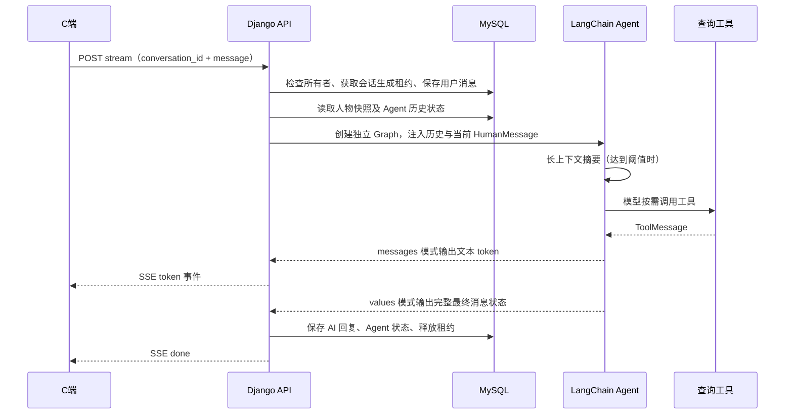

# 聊天机器人与人物 Agent 实现

> 2026-10-03 已接入本地 BGE + pgvector RAG，并增加人物 `tools` 与会话 `persona_tools` 快照，后台可配置工具。博客助手默认启用站内检索及引用约束。详细模块、配置和验证以 [RAG 运行说明](../rag/readme.md) 为准；下文“两种工具”等描述是此前聊天功能的实现记录。

## 功能与使用

C 端 `/chat` 采用类似 DeepSeek 客户端的布局：左侧管理多个聊天，右侧展示当前会话和输入框。支持新建、搜索、切换、重命名、确认删除、自动生成首条消息标题，以及移动端抽屉侧栏。Enter 发送，Shift+Enter 换行，中文输入法组合输入期间不会误发送。

点击“新建聊天”后选择人物，发送第一条消息时创建数据库会话。同一人物也可以创建多个独立聊天。人物在一个会话内固定；要换人物，请新建聊天。开场白是界面展示内容，不会伪装成已经发送的 AI 消息。

S 端 `/chats` 的“人物 Prompt 管理”支持列表查询、查看详情、新增、编辑、删除、启用/停用和排序。下方保留用户聊天记录管理，详情可以按会话切换，支持清空及按天数清理。排序数值越小，人物越靠前。

现在 S 端“聊天管理”有“人物管理”和“聊天记录”两个子页面。人物管理通过后端页码 API 与 Element Plus 分页器按页搜索；聊天记录页的用户总览保留页码分页，用户详情按当前会话请求消息页，切换会话会回到第一页，不再加载其他会话和该用户所有消息。分页参数是 `page` / `page_size`，消息页请求按用户和所属会话双重限定；过大的 page 自动收敛到最后一页，详情每页 20 条、可选 10/20/50。

保留项目现有权限：发送消息和 S 端管理仅允许已认证的 `is_staff` 或 `is_superuser` 用户；人物公开列表和本人会话接口要求登录。服务端所有会话操作都按 `request.user` 限定，客户端不能指定其他用户。C 端的路由和入口也保留管理员聊天限制。

## 数据库存储设计

在现有 Django 默认数据库（PostgreSQL `zdblog`）中新增两张独立业务表，使用现有连接及事务，无需另建物理数据库或添加数据库路由。这里将“人物库”实现为持久化的 `chat_personas` 表。

| 表 | 主要字段 | 用途 |
| --- | --- | --- |
| `chat_personas` | `id`、`name`、`description`、`system_prompt`、`greeting`、`is_active`、`sort_order`、时间戳 | 人物设定库，名称唯一，后台 CRUD |
| `chat_conversations` | `id`、`user_id`、`persona_id`、`title`、`persona_name`、`system_prompt`、`greeting`、`agent_messages`、生成租约及时间戳 | 独立会话、人物快照、完整 Agent 上下文 |
| `chat_messages` | 原有字段加 `conversation_id` | C/S 端展示的用户消息与 AI 回复 |

ID 延续项目的 UUID v7，无连字符、32 位字符串。会话按最近更新时间倒序排列，有 `(user, -updated_at)` 索引；消息按时间和 ID 排序。

创建会话时复制人物名称、System Prompt、开场白。此后修改人物只影响新会话，停用人物后它从 C 端列表消失，删除人物会把已有会话的 `persona_id` 置空，人物快照及历史记录继续可用。删除会话会级联删除其消息和完整上下文。

公开 API 不返回 System Prompt、Agent 原始状态或 reasoning 内容；后台人物详情可以读取并修改 Prompt。会话内 JSON 包含内部推理和工具结果，只用于服务端恢复模型上下文，不用于页面显示。

## 数据迁移

新增迁移：

1. `0003_chatpersona_chatconversation_and_more`：创建人物、会话表，为旧消息添加临时可空的会话外键。
2. `0004_seed_personas_and_migrate_history`：初始化“明日香”和“博客助手”；为每个有旧消息的用户创建一个“历史聊天”，将旧消息关联到该聊天，保留消息正文和原始时间；会话创建/更新时间取旧消息的首尾时间；最后把消息会话外键设为非空。

默认明日香 Prompt 是迁移文件内冻结的原始快照。以后改 `prompts.py` 不会改变已经执行的迁移或数据库人物，运行时 Prompt 以数据库人物/会话快照为准。迁移使用历史模型和当前数据库别名，适用于已有库和全新库。

`0004` 的数据迁移不可逆：多个新会话无法无损合并回旧单会话结构。上线前备份数据库；回退需要恢复数据库备份并与代码版本保持一致。历史 SQLite checkpoint 不参与迁移：当前有效聊天数据来自原有 MySQL `chat_messages`。

## Agent 的详细流程



### 1. 请求校验与会话保护

`views.py` 的 `ChatStreamView` 使用 DRF serializer 校验 `conversation_id` 和消息。消息自动去掉首尾空白，不能为空，最长 10,000 字符；人物 Prompt 最长 20,000 字符，开场白最长 2,000 字符，标题最长 100 字符。

发送前在短数据库事务中 `select_for_update()` 锁定当前用户的会话，写入 `generation_id` 和 `generation_started_at`。同会话已有有效租约则返回 HTTP 409，不重复写入用户消息；不同会话的上下文相互独立。模型/工具网络请求在事务外运行，不长时间占用数据库行锁。

租约有效期 15 分钟，进程崩溃后可在租约过期时重新发送。过期接管会清空旧 Agent JSON，由展示消息重建历史；最终写入时再次检查生成 ID，避免旧 worker 覆盖新请求的结果。回复期间删除会话、后台清空或裁剪消息会返回 409。页面发送期间禁用切换、重命名和删除，避免 token 写进其他聊天。

### 2. 构建 Graph 与模型

`agent.py` 的 `build_agent(system_prompt)` 每次请求创建一个独立的 LangChain `create_agent` Graph，System Prompt 来自会话快照。Graph 不使用全局 `InMemorySaver`，不会依赖 worker 的进程内记忆，避免多进程切换、服务重启及不同会话之间的记忆混用。

`utils.py` 的 `get_llm_model()` 创建 `ChatOpenAI`，适配 DeepSeek 兼容接口，温度转换为浮点数，输出 token 上限转换为整数。请求超时为 120 秒，模型连接重试最多 2 次。当前实现仅支持 `LLM_MODEL=deepseek`，缺少 API Key 或不支持的模型类型会在服务端记录异常，并给客户端返回通用错误。

### 3. 工具循环与摘要

Graph 根据会话 `persona_tools` 快照注册工具，由主模型直接识别任务并选择对应工具，不额外调用意图分析模型。工具结果作为 `ToolMessage` 回到模型；模型可以继续调用工具或生成回复。`handle_tool_errors` middleware 将工具执行异常转换为模型可理解的工具错误消息，避免整个工具循环直接崩溃。

- 天气工具改为 `get_weather(location: str, days: int = 3)`。Agent 先从本轮或上下文提取用户指定地点，没有地点时询问城市；不会使用服务器/IP 位置。`agent.py` 在天气工具启用时追加查询规则，已有会话的角色快照也能使用新规则，无需数据库迁移。
- `weather.py` 先规范化省市（如“安徽省宿州”→“宿州, 安徽”→“宿州市, 安徽”），通过 Open-Meteo Geocoding 获取经纬度并核对省份；同名城市需用户进一步确认。解析失败不改查其他城市。中文地名依赖服务方收录，未收录的详细地址可能需要提供城市名。
- 天气请求按定位经纬度、`timezone=auto`、`forecast_days` 查询当前模型估计和每日预报，默认 3 天、最多 7 天；使用接口返回的当地日期，不使用服务器日期。返回完整地点、时区、气温、体感、风速、每日最高/最低温和降水概率。HTTP 请求设置连接/读取超时并校验状态和数据，失败返回明确错误，不泄露底层异常或编造数据。
- 接口字段依据 [Open-Meteo 地理编码文档](https://open-meteo.com/en/docs/geocoding-api) 与 [天气预报文档](https://open-meteo.com/en/docs)。地点由主模型提取并通过工具参数传递，不另调用模型进行第二次地址提取。`test_weather.py` 覆盖省市解析、错误省份、同名城市、无地点、超时、空预报、工具参数和既有会话规则注入。
- 2026-10-03 天气改动验证：`rag + chat_robot` 共 39 项测试通过；真实调用“安徽宿州”成功解析到安徽宿州市（33.63611, 116.97889），取得当前模型估计及 3 天预报。尝试真实 DeepSeek Agent 联调时连接被远端关闭（WinError 10054），尚未完成真实主模型提取地点及最终回复的端到端验证；该失败与已成功的地理编码、天气接口请求分开记录。重启后端后工具 schema 与规则对启用天气工具的现有会话生效。
- `search_blog` 负责主题、观点和正文语义检索；“最近有什么新文章”不再作为语义关键词搜索。`article_tools.py` 新增 `list_articles`、`count_articles`、`get_article`，仅查询当前公开文章，不依赖 embedding，不会读取草稿或私密文章。
- `list_articles` 默认按 `published_at` 倒序列出最新 5 篇（可取 1～10 篇、offset 翻页），返回标题、180 字内摘要、发布/修改时间、文章 ID、完整链接、筛选结果总数和 has_more。“最近修改”按 `updated_at` 排序；缺失发布时间排到最后并返回 null，不冒充创建时间。可按对应时间字段的 start_date/end_date 和 keyword 子串筛选；这不是语义主题筛选。
- `count_articles` 做数据库精确计数，可用同样的日期和子串条件；禁止用 RAG 的 top-k 推断全站篇数。`get_article` 按工具返回的 ID 读取当前 Markdown 正文，默认 4000 字、可选 500～8000 字，用 offset/next_offset 分页；has_more=true 时不能声称已读完全文。撤回、私密或不存在的 ID 统一返回未找到公开文章。
- 日期范围包含起止日期，默认按中国时区 Asia/Shanghai 转换为数据库时间区间；可通过 `.env` 的 `CHAT_ARTICLE_TIME_ZONE` 调整。Graph 注入该时区的当前日期及博客工具选择规则，支持从上下文解析“第一篇/刚才那篇”；工具未启用时不能用 RAG 冒充列表、计数或正文读取。出处用 `[文章标题](/article/ID)`，不只输出裸路径。
- `0007_article_query_tools` 已执行：为已启用 search_blog 的人物和已有会话追加三项文章工具，删除 0006 引入的那段精确旧规则“所有本站问题必须先 search_blog”，保留其余自定义 Prompt、历史和全关闭配置。后台新增三项独立复选框；以后修改人物工具仍默认仅影响新聊天。本次是一轮明确的数据升级，不是自动跟随人物设置。
- 2026-10-03 文章工具验证：47 项 PostgreSQL 后端测试、后台 Vue 生产构建、迁移一致性检查通过；真实库计数为 9 篇公开文章，最新 5 篇按发布时间正确排序。真实 DeepSeek 选择 `list_articles(sort="published_at", limit=5)` 回答“最近有什么新文章”，不调用 search_blog，出处返回可点击 Markdown 链接；继续追问“第一篇具体讲了什么”，正确提取列表第一项 ID 调用 get_article 并依据正文回答。使用测试进程的直连 HTTP 客户端，未修改应用的代理设置。
- `SummarizationMiddleware` 在约 10,000 tokens 时触发摘要，保留最近 20 条消息，旧消息以摘要替代。完整展示历史仍在 `chat_messages` 中，不因摘要而删除。
- Graph 设置 `recursion_limit=30`，避免模型无限循环调用工具。

### 4. 完整上下文持久化

优先用 LangChain `messages_from_dict()` 从会话的 `agent_messages` JSON 恢复消息。JSON 不仅保存 Human/AI 文本，还保留工具调用、工具结果以及 `additional_kwargs.reasoning_content`。这对 DeepSeek 的工具续轮很重要。

没有 JSON（旧记录、清理后或失败后）时，按会话从 `chat_messages` 恢复 HumanMessage/AIMessage，再追加本次消息。当前请求的用户消息已存库，但恢复所用的数据库历史在写入前读取，因此不会把本次消息重复追加。

`utils.py` 对 `langchain_openai` 的三个消息转换函数做一次性兼容补丁：从 API 普通响应和流式 delta 捕获 reasoning，并在后续模型请求转换时回传。保留空 reasoning 字段；该字段始终不向 C 端 SSE 输出。补丁依赖库的私有接口，升级依赖时应运行 Agent 及流式测试。

### 5. 流式事件投影

Graph 同时使用 `stream_mode=['messages', 'values']`：前者输出 token，后者提供完整状态。只有 `langgraph_node='model'` 的 AI 文本发给客户端；工具节点、工具调用消息和 `lc_source='summarization'` 的摘要被过滤，不再依赖“## SUMMARY”这样的文本前缀猜测。

保留独立的空白 token，让 Markdown 的空格、换行和代码缩进保持正确。AI 最终展示内容仅去掉末尾空白。内部推理不作为正文输出。

SSE 事件格式：

```text
data: {"token":"一段回复"}

data: {"done":true}

```

异常时发送 `data: {"error":"回复失败，请稍后重试"}`，完整异常只在服务器日志中记录。失败或断开时保留已收到的部分 AI 文本、清空不完整的 Agent 状态并释放租约；下一轮根据数据库展示消息重建上下文。成功时最终状态使用 `messages_to_dict()` 保存，与 AI 展示消息一起在短事务中写入，之后才发送 done。

### 6. C 端与 S 端实现

`zdblog-vue-c/src/api/index.js` 用 POST fetch 读取 SSE，附加现有 JWT。`TextDecoder` 连续解码 UTF-8，用缓冲区拼接跨网络分片的事件，显式处理 HTTP 错误、SSE error、异常 EOF、网络错误和 AbortSignal，释放 reader。正常结束后页面从后端刷新消息和标题，以数据库为准。组件销毁时取消请求；历史加载使用版本号，避免快速切换造成旧请求覆盖新会话。

AI Markdown 先经 `marked` 生成，再通过 `utils/chatMarkdown.js` 的 DOM 白名单净化：保留段落、列表、代码、表格等展示标签，移除事件属性、非展示标签和危险 URL scheme，外链附带 `noopener noreferrer`。用户消息以文本展示。人物描述与开场白也以 Vue 文本插值展示。

`zdblog-vue-s/src/components/ChatPersonaManage.vue` 提供独立人物管理组件，挂在现有聊天管理页。后台保存表单有必填校验、长度限制和重复提交保护，服务端再次验证名称唯一性等约束。历史查看按 `conversation_id` 过滤消息，避免把多个会话混在一起。

`user/chat_views.py` 只重新导出新实现，旧 `/api/auth/chat/` 路由也使用一致的数据源和权限。旧调用方发送消息时必须补充 `conversation_id`；旧 history 调用必须补充查询参数，不再隐式混合所有聊天。

## API 清单

所有路径前缀为 `/api/chat-robot/`，认证方式为项目现有 JWT Bearer Token。

| 方法 | 路径 | 功能 |
| --- | --- | --- |
| GET | `personas/` | 启用人物的公开信息，不包含 Prompt |
| GET / POST | `manage/personas/` | 管理人物列表、新增，支持 `search` |
| GET / PUT / PATCH / DELETE | `manage/personas/{id}/` | 人物详情、更新、删除 |
| GET / POST | `conversations/` | 本人会话列表、创建；创建需要 `persona_id`，可带 `title` |
| GET / PATCH / DELETE | `conversations/{id}/` | 会话与消息详情、标题更新、删除 |
| POST | `stream/` | SSE 回复；需要 `conversation_id`、`message` |
| GET | `history/?conversation_id={id}` | 本人指定会话的全部展示历史 |
| GET | `users/` | 后台按用户统计消息，支持 `search`、`page`、`page_size` |
| GET | `users/{user_id}/` | 后台查询会话与消息 |
| POST | `users/{user_id}/clear/` | 清空消息和 Agent JSON，保留会话壳 |
| POST | `users/{user_id}/trim/` | 保留最近 N 天消息，同时清空 Agent JSON；请求体 `{"days":30}` |

示例：

```json
{"persona_id":"人物的32位ID","title":"新聊天"}
```

```json
{"conversation_id":"会话的32位ID","message":"介绍一下你自己"}
```

列表使用 `{"conversations":[...]}`；会话详情使用 `{"conversation":{...},"messages":[...]}`；人物列表直接返回数组；后台用户列表返回 `{"results":[...],"count":数量}`。无效参数返回 400，其他用户的会话返回 404，并发生成返回 409，删除成功返回无内容的 204。

## 配置、部署与验证

保留现有 `.env`，推荐配置如下（密钥仅放环境变量，不写进前端或人物 Prompt）：

```dotenv
LLM_MODEL=deepseek
DEEPSEEK_LLM_MODEL=deepseek-chat
DEEPSEEK_API_KEY=你的密钥
DEEPSEEK_BASE_URL=https://api.deepseek.com
TEMPERATURE=0.7
MAX_TOKENS=4096
```

在已安装 `requirements.txt` 的后端环境执行：

```powershell
cd E:\github\zdblog\zdblog-master
python manage.py migrate
python manage.py check
```

迁移后重启后端，分别在 `zdblog-vue-c`、`zdblog-vue-s` 执行 `npm run build` 并发布各自 dist。开发环境使用各项目现有 `npm run dev`，API 代理保持现有 `/api` 配置。

SSE 响应带 `Cache-Control: no-cache` 和 `X-Accel-Buffering: no`。部署代理需要关闭响应缓冲并适当延长读取超时，Gunicorn 也需要允许较长的流式请求。每个同步生成占用一个 worker，应按并发规模配置 worker 数量。当前没有 SSE 心跳；工具长时间无 token 时，代理可能断开连接。

后端隔离测试使用 SQLite 内存数据库，不读取生产 `.env` 或调用真实模型。需要 Django、DRF、uuid6、LangChain、langchain-openai 和 python-dotenv 等相应依赖：

```powershell
python manage.py test chat_robot --settings=chat_robot.test_settings
python manage.py makemigrations --check --dry-run --settings=chat_robot.test_settings
```

前端流式接口测试及构建：

```powershell
cd E:\github\zdblog\zdblog-vue-c
node --test src/api/chat.test.mjs
npm run build
cd E:\github\zdblog\zdblog-vue-s
npm run build
```

测试覆盖人物 CRUD、权限、用户隔离、独立会话、快照和删除、JSON 上下文恢复、部分失败持久化、并发租约及过期接管、清空/裁剪重置、旧记录数据迁移、真实 Agent 工具循环、摘要/工具过滤和空白 token。前端验证跨分片 UTF-8/SSE、HTTP/网络错误、异常 EOF、取消及 204 删除。

本次验证不调用真实 DeepSeek，不修改现有业务数据库；上线后应使用有效 API Key 验证真实模型和工具网络连接。SQLite 测试不能代替 MySQL 多 worker 下的行锁验证。会话列表和单会话消息目前一次加载全部记录，超大历史可进一步扩展分页、配额和取消生成接口。人物停用不终止已有聊天，人物编辑也不会强制改写已有会话。

Agent API 的官方参考：[create_agent](https://reference.langchain.com/python/langchain/agents/factory/create_agent)、[StreamMode](https://reference.langchain.com/python/langgraph/types/StreamMode)。实现以项目 `requirements.txt` 的依赖版本为准。
